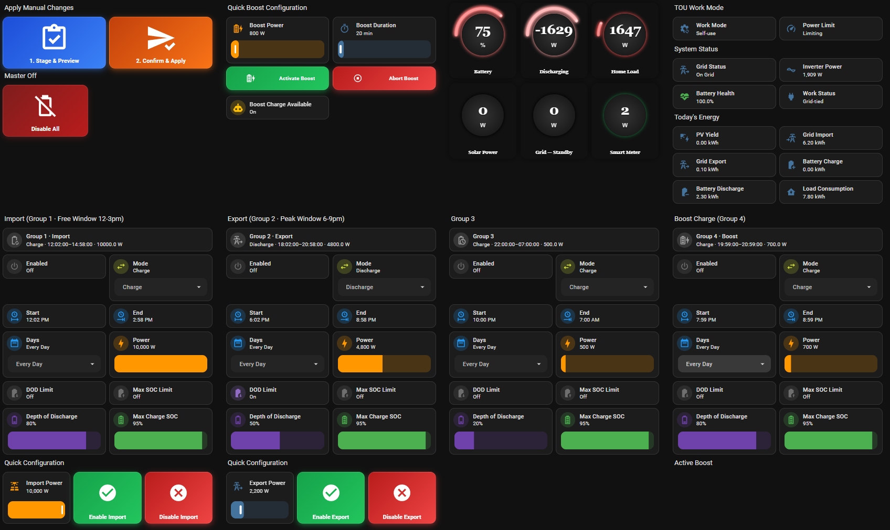
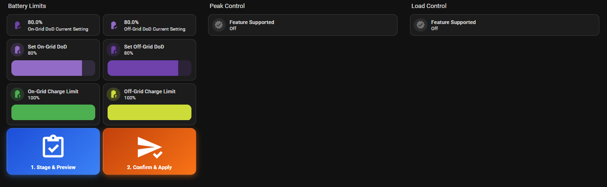

# Dyness Inverter Control

[](https://github.com/aistuartai/Dyness-Inverter-Control/releases)
[](https://github.com/aistuartai/Dyness-Inverter-Control/actions/workflows/tests.yml)
[](https://github.com/hacs/integration)
[](LICENSE)

A Home Assistant integration for **Dyness** home batteries and **Dyness Cygni** hybrid inverters.
It reads live data from the Dyness cloud (Open API) and — on Cygni inverters — lets you **control the
inverter from Home Assistant**: work mode, time-of-use charge/discharge schedules, battery limits,
peak shaving and load relay control.

- **Monitoring** — state of charge, battery / PV / load / grid power, daily and lifetime energy,
  temperatures, cell voltages, per-module data and alarms, ready for the Energy dashboard.
- **Control (Cygni)** — every setting is staged first and only sent to the inverter when you confirm,
  so nothing reaches live hardware by accident.
- **Automation-friendly** — all settings are normal HA entities, plus a `set_tou_schedule` action for
  scripts and automations (e.g. tariff-driven charging).

> ⚠️ The control features write to live inverter hardware and have been tested on one Cygni 10.0HS-M8
> system. Check every value before you confirm a change.



---

## Supported devices

| Device | Monitoring | Control |
|---|:---:|:---:|
| Dyness **Cygni** HA/HS hybrid inverters (tested: Cygni 10.0HS-M8) | ✅ | ✅ |
| Tower T14 / T17, Tower Pro TP7 / TP11 / TP15 | ✅ | — |
| Stack100, DL5.0C, Junior Box | ✅ | — |
| PowerBox Pro / PowerHaus, PowerBox G2, PowerDepot G2 | ✅ | — |
| Other Dyness devices with a WiFi dongle | ⚠️ Basic sensors via automatic detection | — |

The device model is detected automatically and only the sensors your device actually reports are created.
Monitoring for the non-Cygni families comes from the original integration (see [Credits](#credits)) and is
covered by synthetic test data; reports from owners of those devices are welcome.

## Requirements

- Home Assistant **2025.2** or newer
- A Dyness account at [ems.dyness.com](https://ems.dyness.com/login) with the device registered, and an
  **API ID / API Secret** from *Developer Center → API Management*
- Internet access — this is a cloud-polling integration (Europe and Asia-Pacific API regions)

## Installation

**HACS (recommended)**

1. HACS → **⋮** → **Custom repositories** → add `https://github.com/aistuartai/Dyness-Inverter-Control`, category **Integration**.
2. Search for **Dyness Inverter Control**, download it, and restart Home Assistant.

**Manual**

Copy `custom_components/dyness_battery_cygni` into your `config/custom_components/` folder and restart Home Assistant.

## Configuration

1. **Settings → Devices & Services → Add Integration → Dyness Inverter Control.**
2. Enter your API ID and API Secret, choose your **region** (Europe or Asia-Pacific) and a polling interval.
3. If the account has several devices you'll be asked which one to add; add the integration again for each extra device.

The polling interval can be changed later under **Configure**:

| Interval | Calls / hour (1 module) | Notes |
|---|---|---|
| 2 min | ~40 | Aggressive — watch the log for rate-limit (429) warnings |
| 3 min | ~27 | |
| **5 min** | ~16 | **Default** |
| 10 min | ~8 | |
| 15 min | ~5 | |

With 3 or more battery modules the interval is raised automatically (10 or 15 min) to stay inside the Dyness API limit.

## Controlling the inverter (Cygni)

All writes follow the same **Stage → Confirm** pattern:

1. Change the settings entities (switches, times, numbers, selects) — nothing is sent yet.
2. Press **Stage …** — the values are validated and a notification shows exactly what will be sent.
3. Press **Confirm & Apply …** — only now is the change sent to the inverter.

### Work mode

`select.<device>_work_mode` — *Self-use*, *Backup* or *TOU (Time of Use)*. Off-grid mode must be set on the inverter itself.

### Time-of-use schedule

Four charge/discharge groups, each with:

| Setting | Range |
|---|---|
| Enabled | On / Off |
| Start / End time | Time of day (windows may cross midnight) |
| Mode | Charge / Discharge |
| Days | Every day, weekdays, weekends, or a single day |
| Power | 0 – 2,000 W (100 W steps) — the Dyness API limit |
| Discharge depth limit | On / Off + 0–95 % |
| Max charge SOC limit | On / Off + 10–100 % |

Applying a schedule switches the inverter to TOU mode and always sends all four groups.

### Battery limits

| Setting | Range |
|---|---|
| On-grid / Off-grid discharge depth | 0–95 % |
| On-grid / Off-grid charge limit | 10–100 % |

The inverter reports its actual discharge depths, so these two settings show `inverter_value` and `in_sync`
attributes, and the Stage preview flags any value that differs from what HA holds (usually because it was
changed in the Dyness app).

### Peak control *(enable "Peak Control Supported" first)*

Peak shaving: within a time window the battery covers the load so grid import stays below a set power.

| Setting | Range |
|---|---|
| Enabled | On / Off |
| Trigger SOC | 0–100 % |
| Time window | Start + End |
| Power limit | 0–10,000 W (10 W steps) |

### Load control *(enable "Load Control Supported" first)*

| Setting | Range |
|---|---|
| Load switch | On / Off |
| Force-close window | Start + End |
| Force close off-grid only / Always close on grid | On / Off |
| Relay close / open SOC | 0–100 % |
| PV power threshold | 0–10,000 W |



### `set_tou_schedule` action

Send a whole schedule from a script or automation (times are `HH:mm`, days use `0` = Monday … `6` = Sunday):

```yaml
action: dyness_battery_cygni.set_tou_schedule
data:
  groups:
    - group: 1
      enabled: true
      start_time: "12:00"
      end_time: "15:00"
      mode: charge
      power: 2000
      days: "0,1,2,3,4,5,6"
    - group: 2
      enabled: false
      start_time: "18:00"
      end_time: "21:00"
      mode: discharge
      power: 0
```

With more than one Dyness device set up, add `config_entry_id` to choose which one receives it.

## Example dashboards

Two ready-to-import dashboards (shown above) are in [`docs/dashboards/`](docs/dashboards/):

| Dashboard | File | Shows |
|---|---|---|
| TOU Settings | [tou-dashboard.yaml](docs/dashboards/tou-dashboard.yaml) | All 4 TOU groups, Stage / Confirm buttons, system status |
| Battery Settings | [settings-dashboard.yaml](docs/dashboards/settings-dashboard.yaml) | Battery limits, plus Peak / Load Control sections that appear once their *Supported* switch is on |

They need two HACS frontend cards: [Mushroom](https://github.com/piitaya/lovelace-mushroom) and
[button-card](https://github.com/custom-cards/button-card).

**To import:** Settings → Dashboards → *Add dashboard* → open it → ✏️ → **⋮ → Raw configuration editor** → paste the file.
The entity ids use the prefix `garage_dyness_cygni_`; replace `garage` with your own device name
(Developer Tools → States, filter `dyness_cygni`).

The TOU dashboard also has a few buttons wired to my own tariff automations (`input_button.tou_*`,
`input_number.tou_*`, a boost-charge automation). They do nothing without matching helpers — create your own
or delete those cards; the core TOU controls work on their own.

## Partial-backup installations

Many installs put only some circuits on the inverter's **backup** (EPS) port; heavy loads such as an oven, cooktop
or garage stay on a **non-backup** board that is wired on the grid side of the inverter:

```text
street ── meter ──┬── non-backup board (oven, stove, garage)
                  │
                  └── inverter grid port ── Dyness inverter ── backup port ── backup board (everything else)
```

The Dyness API only reports the inverter's own ports, not the street meter, so in this layout:

| Entity | What it really measures |
|---|---|
| **Grid Power** | Power through the inverter's **grid port**, not the street meter. Battery or solar power feeding the non-backup board leaves through this port and shows as **export**. |
| **Load Power** | Backup-board circuits only. The non-backup board is missing. |
| **Today / Total Grid Import / Export** (kWh) | The street meter — correct, but in 0.1 kWh steps. |

Example: the oven running on battery showed Grid Power ≈ −2.2 kW ("exporting") and Load Power 1.3 kW, while the
street meter read ≈ 0 W and the meter export counter did not move.

**Energy dashboard:** use the kWh import / export sensors (meter-based) for grid consumption and return to grid,
never an integration of Grid Power.

**Live power:** the API has no live street-meter power. With a separate meter on the incoming supply (for example a
Zigbee meter that reads the meter's LED, giving import power), template sensors can work out the real figures. Port
outflow counts as non-backup load unless the house is exporting; exporting is judged from the meter export counter
rising (or the battery being nearly full with surplus solar). Add to `configuration.yaml` and change the entity ids
to yours:

```yaml
template:
  - sensor:
      - name: Dyness grid port outflow
        unique_id: dyness_grid_port_outflow
        unit_of_measurement: W
        device_class: power
        state_class: measurement
        state: >-
          {{ [0, 0 - states('sensor.garage_dyness_cygni_grid_power') | float(0)] | max | round(0) }}
      # True grid: + import, - export
      - name: Home grid power
        unique_id: home_grid_power
        unit_of_measurement: W
        device_class: power
        state_class: measurement
        state: >-
          
          
          {{ (imp - exp) | round(0) }}
      # Non-backup board: port outflow when not exporting, plus street import not going into the inverter
      - name: Home non-backup load
        unique_id: home_non_backup_load
        unit_of_measurement: W
        device_class: power
        state_class: measurement
        state: >-
          
          
          
          {{ (out + [0, imp - [0, port] | max] | max) | round(0) }}
      - name: Home total load
        unique_id: home_total_load
        unit_of_measurement: W
        device_class: power
        state_class: measurement
        state: >-
          {{ (states('sensor.garage_dyness_cygni_load_power') | float(0)
              + states('sensor.home_non_backup_load') | float(0)) | round(0) }}
  - binary_sensor:
      - name: Dyness exporting
        unique_id: dyness_exporting
        state: >-
          {{ states('sensor.dyness_grid_port_outflow') | float(0) > 50
             and (is_state('binary_sensor.dyness_export_counter_rising', 'on')
                  or (states('sensor.garage_dyness_cygni_state_of_charge') | float(0) >= 98
                      and states('sensor.garage_dyness_cygni_pv_power') | float(0)
                          > states('sensor.garage_dyness_cygni_load_power') | float(0) + 100)) }}
  # On whenever the meter export counter goes up; held 15 min because small exports tick it slowly
  - trigger:
      - trigger: state
        entity_id: sensor.garage_dyness_cygni_today_grid_export
    binary_sensor:
      - name: Dyness export counter rising
        unique_id: dyness_export_counter_rising
        state: >-
          {{ trigger.from_state is not none and trigger.to_state is not none
             and trigger.to_state.state | float(0) > trigger.from_state.state | float(0) }}
        auto_off: "00:15:00"
```

Notes:

- Don't assume export only happens with a full battery: on sunny days solar can exceed the charge rate (or the
  battery tapers near full) and the system exports below 100 %. A TOU *Discharge* group can also force export.
- Dyness values update every few minutes while a local meter is live, so the figures can spike briefly when they
  are out of step. A 5-minute [`statistics`](https://www.home-assistant.io/integrations/statistics/) sensor
  (`characteristic: average_step`, `max_age: 00:05:00`) on each one smooths this for dashboards.
- Without a separate meter, drop the meter terms: *Home grid power* then shows export only, and non-backup loads
  supplied from the street (rather than by the inverter) are missed.
- Non-backup loads used while the house is exporting can't be seen; they just reduce the export.

## Good to know

- **TOU power is limited to 2,000 W through the API.** Dyness rejects higher values ("Request parameter
  exception") even though the inverter can charge faster; the Dyness app still accepts higher rates. Set fast-charge
  groups in the app, or keep HA-managed groups at 2,000 W or below. Stage catches values that are too high.
- **No read-back for schedules.** The Dyness API cannot read the TOU, peak or load settings back, so HA shows
  what it last sent (restored across restarts). Changes made in the Dyness app are not seen by HA, and confirming
  from HA overwrites them.
- **Discharge groups run at a fixed power.** A TOU *Discharge* group discharges at its set power whatever the
  house is using. To keep grid import near zero in a time window, Peak Control (which follows the load) works better.
- **Grid power sign.** HA shows grid power positive when importing; the Dyness app shows it positive when exporting.
- **On/off conventions differ by setting.** For the TOU group switches the hardware uses `1 = On` (the API documentation
  says the opposite); for Peak Control the hardware uses `0 = On`, as documented. Load Control follows the documentation
  (`0 = On`) but has not been verified on hardware. Versions before 2.8.2 sent Peak Control the wrong way round —
  confirming "enabled" from HA switched it **off**.

## Troubleshooting

- **Sensors unavailable / "Network Anomaly" in the log** — the Dyness cloud is slow or failing. Each request gives
  up after 20 s and the rest of the update continues; persistent problems are on the Dyness side.
- **Oven or other big loads show as export / house load too low** — those circuits are on a non-backup board; see
  [Partial-backup installations](#partial-backup-installations).
- **Rate-limit (429) warnings** — use a longer polling interval.
- **Wrong or missing values** — enable debug logging for the integration (Settings → Devices & Services →
  Dyness Inverter Control → ⋮ → *Enable debug logging*); raw API responses are written to the log. Remove your
  serial numbers before sharing it in an issue.

Report problems in [Issues](https://github.com/aistuartai/Dyness-Inverter-Control/issues).

## Upgrading from 2.7.x

See the [2.8.0 release notes](https://github.com/aistuartai/Dyness-Inverter-Control/releases/tag/v2.8.0). In short:
Home Assistant 2025.2+ is required; the Peak / Load Control sliders now take effect (re-check them before your next
Confirm); nine nameless duplicate `number.` / `time.` entities are removed automatically; "Power Limit Active" is
renamed "Export Limit" (existing entity ids are kept).

## Development

Tests use [pytest-homeassistant-custom-component](https://github.com/MatthewFlamm/pytest-homeassistant-custom-component)
and run on Linux / macOS (WSL on Windows). Fixtures in `tests/fixtures/` are real API responses with every identifier
replaced; other models use clearly labelled synthetic data.

```bash
pip install -r requirements_test.txt
pytest --cov
```

On Windows, `scripts/test.ps1 setup` creates a WSL environment and `scripts/test.ps1` runs the suite. GitHub Actions
runs the tests, ruff, hassfest and HACS validation on every push.

## Credits

Based on [shopf/dyness_battery](https://github.com/shopf/dyness_battery), which provides the cloud API handling,
device schema detection and multi-model battery monitoring. This project adds the Cygni inverter control layer,
the test suite and the fixes described in the release notes.

## License

MIT — see [LICENSE](LICENSE).
